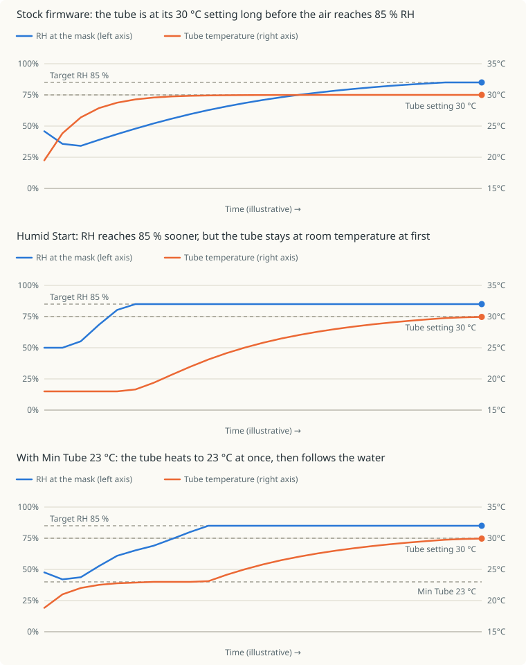

# General Features

These features expand the modes, settings, recording, and hardware options
available on supported AirSense 10 and AirCurve 10 firmware. They are included
in the standard patched images unless noted otherwise.

## All Therapy Modes

AirSense 10 and AirCurve 10 variants from the same firmware generation share
the underlying therapy implementations. 
The device-specific configuration
normally limits the mode selector to the modes sold with a particular model.
The patch removes that restriction, exposing CPAP, AutoSet, APAP, S, ST, T,
VAuto, ASV, ASVAuto, iVAPS, PAC, and AutoSet for Her.

<p align="center">
  
  
</p>

This patch changes only mode availability. It does not expose the related
clinical settings; that is handled by the clinical settings patch below.
It also leaves the model's original EDF signal selection unchanged. Full recording
for the additional modes requires the EDF merge patch.

## Clinical Settings and Pressure Range

The clinical menu exposes the settings associated with the unlocked therapy
modes, including mode-specific pressure, timing, trigger, cycle, and comfort
controls.
The menu continues to show only settings relevant to the currently
selected mode.

Standard pressure controls are expanded to the full 1.0 to 30.0 cmH2O range.

<p align="center">
  
</p>

## Fall Time

This optional patch adjusts the stock pressure transition from IPAP to EPAP
in S, ST, T, PAC, and iVAPS. Longer times make the pressure fall more gradually.
S/ST/T/PAC use a linear fall; iVAPS retains its curved pressure transition.
In S, turn Easy-Breathe Off to use Fall Time.

With custom settings, clinical **Therapy** contains:

| Setting | UART | Values | Default |
|---------|------|--------|---------|
| Fall Time | RCW | 100-900 ms, step 50 ms | 100 ms |

Without custom settings, the stock fall remains unchanged.
In S/ST/T/PAC, [Square Wave](squarewave.md) supplies its own pressure
waveform; turn it Off to use Fall Time.

## ST iBR

This optional patch adds adaptive backup timing in ST. With **iBR Off**, the
existing **Backup Rate** (`RRT`) sets the fixed backup frequency. With **iBR On**,
the same setting supplies the target rate for adaptive backup.

After a spontaneous breath, the machine allows up to 1.5 times the target breath
period before delivering a timed breath. Successive timed breaths shorten this
period toward the target: approximately 1.5, 1.375, 1.25, 1.125, then 1 times the
target period. A spontaneous trigger restarts this sequence.

With custom settings, clinical **Therapy** contains:

| Setting | UART | Values | Default |
|---------|------|--------|---------|
| iBR | RXW | Off, On | Off |

Without custom settings, ST retains its stock fixed backup rate.

## iVAPS AutoEPAP

This optional patch adds Lumis-style automatic EPAP adjustment to iVAPS.
It raises EPAP in response to inspiratory flow shape and sustained
reductions in flow, then gradually lowers it when those responses subside.
The existing iVAPS controller continues to adjust pressure support toward
Target Va.

With custom settings, clinical **Therapy** contains:

| Setting | UART | Values | Default |
|---------|------|--------|---------|
| AutoEPAP | RSA | Off, On | Off |
| Min EPAP | RDF | iVAPS EPAP range, step 0.2 cmH2O | 5.0 cmH2O |
| Max EPAP | RDM | iVAPS EPAP range, step 0.2 cmH2O | 15.0 cmH2O |

With AutoEPAP On, Min/Max EPAP replace the fixed EPAP setting in the menu.
If Fall Time is installed, flow-shape analysis uses its selected duration.

## Target Humidity

This patch lets users adjust humidification above or below the stock
85% relative humidity target, in both Auto and Manual Climate Control.
Lower targets reduce the requested moisture; higher targets increase it.
Manual humidity levels remain available and work alongside this setting.

With custom settings, **Target RH (%)** appears in clinical **Accessories**:
70-100%, in steps of 1 percentage point. The setting is saved across restarts
and is also available over UART as `RCH`. The default is 85%, unless a different
value is selected when building the image.

Without custom settings, the target stays at the value selected when building.
Without this patch, the stock 85% target remains unchanged.

The percentage is a target, not a measurement of humidity at the mask.
Higher targets increase condensation risk; 100% targets saturation.

## Humid Start

At the start of therapy, the heated tube normally reaches its temperature
within minutes, while the humidifier plate takes much longer to heat the water.
Until then the air is warm but dry. This optional patch (SX567 only) holds
the tube back while the humidifier warms up.

### How it works

During warm-up, the tube setpoint is capped at the temperature where the
estimated humidity gives the target RH (85%, or the
[Target Humidity](#target-humidity) setting). While the water is cold the
estimated moisture is small, so the cap is low and the tube heater stays off.
As the plate warms, the estimate rises, the cap follows it up, and the tube
warms with it, so the air never gets much warmer than the humidity can support.

<p align="center">
  
</p>

The charts show the idea in an 18 °C room with a 30 °C tube setting and an 85%
target. The axis values are real units, but the curves and the time axis are
illustrative, not measurements. With stock firmware the tube reaches its setting
within a few minutes, while the air is still drier than the target. With Humid
Start the tube stays near room temperature until the water can support the
target, then follows the water up, so the RH reaches the target sooner and stays
there. The third chart adds [Min Tube](#min-tube) at 20 °C: the tube heats to
20 °C at once and waits there, so the first air is warmer, and the RH reaches the
target about a minute later.

- The cap is never lower than 16 °C, the lowest tube setting, or the
  [Min Tube](#min-tube) setting. The tube heater stays off while the measured
  tube is above the cap.
- The humidity model keeps aiming for the full tube temperature, so the plate
  heats at full demand.
- It applies only to Auto climate control with a heated tube and the humidifier
  active.
- How fast the tube warms depends on how far its setpoint is above the measured
  temperature. A cap only 1 to 3 °C above the tube heats it slowly (about 0.3 to
  0.6 °C per minute in tests); a released tube heated at about 2 °C per minute.
  A higher cap therefore makes the tube warm both higher and faster.

### When warm-up ends

Warm-up ends when the first of these happens:

- the cap reaches the tube temperature setting;
- the plate has stopped rising: it is checked every 4 minutes, and must have
  risen less than 0.2 °C per minute on average while at least 8 °C above the
  ambient reading;
- 60 minutes have passed.

The tube is then released to its setting. The humidity model keeps aiming for
that setting until the measured tube is within 1 °C of it (at most 5 minutes).
Without this, the model would switch to the lower measured tube temperature at
that moment, ask for less moisture, and the plate would cool by several degrees
before recovering.

Warm-up restarts after the tube controller has been idle for a minute, for
example between therapy sessions. A hot water chamber, such as after a stock
Warm-up, ends it immediately. After a pause with the mask off, the tube can be
held back again briefly if the plate has cooled.

### How the moisture is estimated

The device has no humidity sensor in the air path, so the moisture the chamber
adds is estimated. The stock humidifier is open loop: it sets the heater duty
from the moisture the air needs, `duty = k0 + k1 × flow × ΔAH` with flow in
L/min and ΔAH in g/m³, using a calibration the device loads at boot, and only
limits the plate near 63-68 °C. Humid Start estimates the added moisture as the
smaller of two bounds:

| Bound | Estimate | Fits |
|-------|----------|------|
| Plate | the saturation humidity gained from `ambient` to `ambient + coupling × (plate − ambient)`; nothing while the plate is at room temperature | while the water heats |
| Heater power | `(duty − k0) / (k1 × flow)`, with the measured duty `HPM` and average blower flow `AFL` | once the water is warm |

The room's own moisture is added to the smaller bound. `k0` and `k1` are read at
runtime, so each device uses its own calibration. Stock only runs its model at 8
L/min or more; below that, or without a usable calibration, only the plate bound
applies.

**The heater-power bound cannot be used during warm-up.** It assumes all the
heater power becomes vapour, which is only true once the water is warm. While it
warms, most of the power heats the water and the plate. The measured duty also
carries no warm-up information: it stays nearly constant from the first sample,
even before any flow. In tests the power bound claimed about 20 g/m³ in the first
minute, when the water was cold, which would let the tube heat straight away. In
steady state the heat in equals the evaporation plus the losses, so the power
bound is the right figure there. The plate bound has the right shape for
warm-up, because the moisture rises as the water warms, but its scale is set by
the coupling.

The estimate is not a measurement and not a proven upper bound. It is probably
too high in the first minutes, because the water lags the plate, and when it
would exceed saturation, since air cannot hold more than that. In steady state
it is the stock model's own prediction, which could be off in either direction.
It has not been checked against a hygrometer.

### Start Coupling

The coupling is the fraction of the plate's rise above room temperature over
which the air leaving the chamber is assumed to pick up moisture. It scales the
plate bound, so it only matters while the plate bound is the smaller one: during
the first minutes. It has no effect once the heater-power bound takes over. The
default is **0.30**, which has not been calibrated.

- **Lower values** estimate less moisture while the plate warms, so the cap is
  lower, the tube is held colder for longer, and the air in the first minutes is
  more humid. There is more risk of condensation in the tube.
- **Higher values** estimate more moisture, so the tube warms sooner. The early
  air is warmer and drier, and condensation is less likely.

In tests the power bound took over after about 2 to 3 minutes with a coupling of
0.30, about 4 to 5 minutes with 0.25, and about 7 minutes with 0.20. With 0.30 the
estimated moisture was therefore flat after the first few minutes while the plate
was still heating, which suggests 0.30 is too generous. The differences between
neighbouring values are small and only show in the first minutes. The measured
tube temperature over the first 15 minutes shows them better than condensation
does.

**Calibrating it from steady state.** Once the plate sits at its limit, the
power bound is the stock model's own prediction. Choose the coupling so the plate
bound reaches that value at that point:

```
ah_sat(T) = ah_sat(ambient) + power bound     solve for T
coupling  = (T − ambient) / (plate − ambient)
```

where `ah_sat(T) = 4.61 + 0.436 T + 0.00122 T² + 0.000427 T³` g/m³. For a plate at
68 °C, ambient 32 °C and a power bound of 13.7 g/m³ this gives about 0.18. This
assumes the stock calibration is right in steady state.

A practical procedure is to start at 0.30 and step down by 0.05 on successive
nights, keeping the tube setting, target RH and water level the same, until you see
condensation near the mask, then keep the previous value. If 0.30 already
condenses, raise it.

### Min Tube

In a cold room the tube would otherwise stay near 16 °C at the start, and the air
is cold until the water can support the target RH. Min Tube sets the lowest
temperature the cap can have. The tube heats to it as soon as possible and stays
there until the estimated moisture allows more, then the cap follows the water up
as usual. For example, with Min Tube at 23 °C, the first air is at least 23 °C
even if the water is still cold.

- The default is **16 °C**, which is the lowest tube setting and the same as
  without the setting. The range is 16-30 °C, in steps of 1 °C.
- A higher minimum makes the first minutes warmer and drier, because the tube
  is hotter than the water can support. The RH at the mask stays below the
  target until the water catches up. Choose the lowest value that is comfortable.
- A minimum at or above the tube temperature setting ends Humid Start at once,
  so the tube behaves as stock.
- The value is whole °C. It is not converted when the device shows °F.

### Settings

With custom settings, clinical **Accessories** contains:

| Setting | UART | Values | Default |
|---------|------|--------|---------|
| Humid Start | first free on/off slot | Off, On | On |
| Min Tube (C) | RDH | 16-30 °C, step 1 | 16 |
| Start Coupling | RDW | 0.10-1.00, step 0.05 | 0.30 |

Without custom settings, or when no label string is left for a setting, it
keeps its default: no minimum beyond 16 °C, and a coupling of 0.30 (the constant
in `patches/humid_start_abi.S`).

Each setting needs a label string, and the switch also an on/off variable,
that no other installed feature uses. The `plus` image uses all of them, so
build it without features you don't need. Each one frees what its own settings
used; for example, without ST iBR and AutoEPAP:

```
make build/stm32-plus.bin AIR10_PATCH_ARGS='--patch-st-ibr n --patch-autoepap n --patch-humid-start y'
```

The switch is added first, then Min Tube, then Start Coupling. The
[Header climate](#header-climate) switch, when installed, takes what Humid
Start leaves. When no label is left for a setting it is skipped: without the
switch Humid Start stays on. The build log reports what was added.

Enable it with `--patch-humid-start y` or `PATCH_HUMID_START=1`. It is off by
default and requires font repacking (on by default).

## Header Clock

Enable **Clock** in clinical **Configuration** to replace the Home and active
therapy-screen titles with the device time in 24-hour `HH:MM` format.

## Header Climate

This optional readout (SX567 firmware) replaces the Home and therapy-screen
titles with the climate values, for example `27.4° 41.0° 85%` (`27° 41° 85%`
with decimals off):

| Field | Source |
|-------|--------|
| Tube temperature | Measured `HTT`; `--` without a heated tube |
| Humidifier plate temperature | Measured `HPT` |
| Relative humidity | Estimated at the tube temperature |

Temperatures follow the device's °C/°F setting. The readout appears only with a
humidifier attached; without one, the clock shows instead. Outside therapy
there is no airflow, so the RH value is the room air at the tube temperature.
Menu screens keep their own titles unless [Always show](#always-show) is on. The
page counter (for example `1/3`) is hidden while the readout is shown.

The device has no humidity sensor in the air path, so the RH value is
estimated in the same way as [Humid Start](#humid-start): the room air plus
the smaller of the plate and heater-power bounds on the added moisture,
divided by the saturation humidity at the tube temperature. The plate bound
uses the same Start Coupling (default `0.3`, in `patches/header_clock_abi.S`).
Treat the value as a guide to the trend, not a measurement. It is probably too
high in the first minutes, can read 100% when the estimate is above saturation,
and has not been checked against a hygrometer.

With custom settings, clinical **Configuration** gets a **Climate** switch
(Off, On; default On) next to **Clock**. Off shows the clock, or the stock
title, again. The switch needs a free on/off variable and label string, like
the Humid Start switch, and gets them after it; without one the readout stays on.

Enable it with `--patch-header-climate y` or `PATCH_HEADER_CLIMATE=1`. It is off
by default, needs the header clock patch (on by default), and is independent
of the **Clock** setting.

### Always show

`--patch-header-climate-always y` shows the readout in every screen title, so
menus such as Settings and My Options show it instead of their names. It needs
`--patch-header-climate`, follows the **Climate** switch, and is a build option
in the patcher window under the header options. Screens without a humidifier
keep their stock titles.

### Decimals

`--patch-header-climate-decimal` (on by default) shows the tube and plate
temperatures with one decimal, `27.4`. Use `--patch-header-climate-decimal n` for
whole degrees, `27`. It is a build option in the patcher window and has no
effect without `--patch-header-climate`.

## Keep Backlight

Hold the dial for three seconds to toggle screen keep-awake.
Home and dial illumination blink once when enabled and twice when disabled.
The switch works during therapy and in standby, and starts Off after reboot.

## Motor Runtime Warning

The patch removes the "Motor life exceeded" nag screen that stock firmware can
show after roughly 20,000 blower runtime hours.

Only the warning screen is removed. The device still tracks and reports its
actual runtime hours,
and no therapy records, service information, or usage data are erased.

## EDF Recording

Stock Air10 variants and therapy modes record different subsets of the
available EDF data. The patch enables a common recording superset so switching
therapy mode does not remove data that the firmware is able to record.

The files remain standard EDF files on the SD card. Signals not used or
produced by the active therapy mode or connected hardware may remain empty or
zero, and the additional channels can make the files slightly larger.

## myAir Cloud Compatibility

myAir accepts sessions only when the selected therapy mode is supported by the
reported device model. Using a mode unlocked from another AirSense or AirCurve
variant can otherwise cause cloud reporting to be rejected.

The patch keeps the reported model compatible with the selected therapy mode
while preserving the device serial number and existing cloud provisioning.

## Replacement LCD Driver

An optional universal LCD driver supports ILI9325 and ILI9328 panels, which are
among the most readily available replacement displays for these devices. This
allows a compatible replacement panel to be used when the original display is
damaged or unavailable.

The controller is detected at startup. Devices with the original ILI9341 panel
continue to use the stock display path, so the same patched image can support
both the original and replacement controllers. Enable this driver when
building with `PATCH_S10_LCD=1`.
