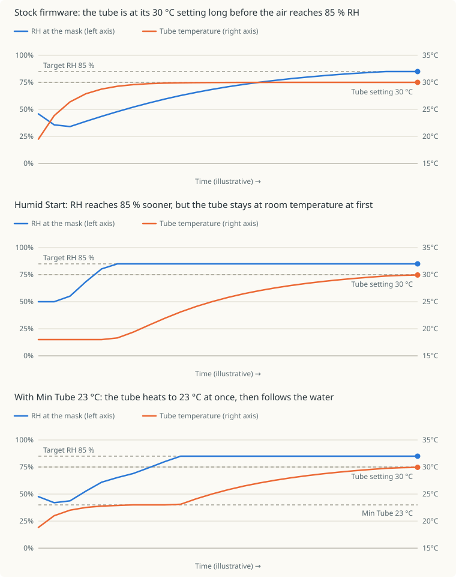

# Humid Start

At the start of therapy, the heated tube normally reaches its temperature
within minutes, while the humidifier plate takes much longer to heat the water.
Until then the air is warm but dry. This optional patch (SX567 only) holds
the tube back while the humidifier warms up.

## How it works

During warm-up, the tube setpoint is capped at the temperature where the
estimated humidity gives the target RH (85%, or the
[Target Humidity](general.md#target-humidity) setting). While the water is cold the
estimated moisture is small, so the cap is low and the tube heater stays off.
As the plate warms, the estimate rises, the cap follows it up, and the tube
warms with it, so the air never gets much warmer than the humidity can support.

<p align="center">
  
</p>

The charts show the idea in an 18 °C room with a 30 °C tube setting and an 85%
target. The axis values are real units, but the curves and the time axis are
illustrative, not measurements. With stock firmware the tube reaches its setting
within a few minutes, while the air is still drier than the target. With Humid
Start the tube stays near room temperature until the water can support the
target, then follows the water up, so the RH reaches the target sooner and stays
there. The third chart adds [Min Tube](#min-tube) at 23 °C: the tube heats to
23 °C at once and waits there, so the first air is warmer, but the RH reaches
the target later.

- The cap is never lower than 16 °C, the lowest tube setting, or the
  [Min Tube](#min-tube) setting. The tube heater stays off while the measured
  tube is above the cap.
- The humidity model keeps aiming for the full tube temperature, so the plate
  heats at full demand.
- It applies only to Auto climate control with a heated tube and the humidifier
  active.
- How fast the tube warms depends on how far its setpoint is above the measured
  temperature. A setpoint only 1 to 3 °C above the tube heats it slowly (about
  0.3 to 0.6 °C per minute in tests); a released tube heated at about 2 °C per
  minute. With the setpoint equal to the cap, the tube would lag below the cap
  and the RH would read above the target. So while the tube is below the cap,
  the setpoint leads the cap by four times the remaining gap, never above the
  tube setting. The heater works harder and the tube follows the cap closely.
  The lead falls back to zero as the tube reaches the cap.

## When warm-up ends

Warm-up ends when the first of these happens:

- the cap reaches the tube temperature setting;
- the plate has stopped rising: it is checked every 8 minutes, and must have
  risen less than 0.05 °C per minute on average while at least 8 °C above the
  ambient reading;
- 60 minutes have passed.

The tube is then released to its setting. The humidity model keeps aiming for
that setting until the measured tube is within 1 °C of it (at most 5 minutes).
Without this, the model would switch to the lower measured tube temperature at
that moment, ask for less moisture, and the plate would cool by several degrees
before recovering.

## When warm-up restarts

Humid Start has no signal for the start of therapy. It sees only that the tube
controller keeps asking for the tube setpoint while therapy runs. Warm-up
restarts when:

- the controller has not asked for a minute, which marks a new session, for
  example the next night. How long the controller stays silent during a short
  pause, such as with the mask off, has not been measured, so such a pause may
  or may not be long enough to restart it;
- you change the tube temperature or the target humidity during therapy.

Each restart checks again whether the tube needs holding back. Warm-up ends
at once if the water already supports your full tube setting, for example after
a stock Warm-up. The tube then heats to its setting at stock speed (about 2 °C
per minute), so the air can be humid while the tube is still cool, which can
cause a little condensation, as with stock. If the water supports less than the
tube setting, the tube is held at the cap until the water warms.

## How the moisture is estimated

The device has no humidity sensor in the air path, so the moisture the chamber
adds is estimated. The stock humidifier is open loop: it sets the heater duty
from the moisture the air needs, `duty = k0 + k1 × flow × ΔAH` with flow in
L/min and ΔAH in g/m³, using a calibration the device loads at boot, and only
limits the plate near 63-68 °C. Humid Start estimates the added moisture as the
smaller of two bounds:

| Bound | Estimate | Fits |
|-------|----------|------|
| Plate | the saturation humidity gained from `ambient` to `ambient + coupling × (plate − ambient)`; nothing while the plate is at room temperature | while the water heats |
| Heater power | `(duty − k0) / (k1 × flow)`, with the measured duty `HPM` and average blower flow `AFL` | once the water is warm |

The room's own moisture is added to the smaller bound. `k0` and `k1` are read at
runtime, so each device uses its own calibration. Stock only runs its model at 8
L/min or more; below that, or without a usable calibration, only the plate bound
applies.

**The heater-power bound cannot be used during warm-up.** It assumes all the
heater power becomes vapour, which is only true once the water is warm. While it
warms, most of the power heats the water and the plate. The measured duty also
carries no warm-up information: it stays nearly constant from the first sample,
even before any flow. In tests the power bound claimed about 20 g/m³ in the first
minute, when the water was cold, which would let the tube heat straight away. In
steady state the heat in equals the evaporation plus the losses, so the power
bound is the right figure there. The plate bound has the right shape for
warm-up, because the moisture rises as the water warms, but its scale is set by
the coupling.

The estimate is not a measurement and not a proven upper bound. It is probably
too high in the first minutes, because the water lags the plate, and when it
would exceed saturation, since air cannot hold more than that. In steady state
it is the stock model's own prediction, which could be off in either direction.
It has not been checked against a hygrometer.

## Start Coupling

The coupling is the fraction of the plate's rise above room temperature over
which the air leaving the chamber is assumed to pick up moisture. It scales the
plate bound, so it only matters while the plate bound is the smaller one: during
the first minutes. It has no effect once the heater-power bound takes over. The
default is **0.25**, which has not been calibrated.

- **Lower values** estimate less moisture while the plate warms, so the cap is
  lower, the tube is held colder for longer, and the air in the first minutes is
  more humid. There is more risk of condensation in the tube.
- **Higher values** estimate more moisture, so the tube warms sooner. The early
  air is warmer and drier, and condensation is less likely.

In tests the power bound took over after about 2 to 3 minutes with a coupling of
0.30, about 4 to 5 minutes with 0.25, and about 7 minutes with 0.20. With 0.30 the
estimated moisture was therefore flat after the first few minutes while the plate
was still heating, which suggests 0.30 is too generous. The differences between
neighbouring values are small and only show in the first minutes. The measured
tube temperature over the first 15 minutes shows them better than condensation
does.

**Calibrating it from steady state.** Once the plate sits at its limit, the
power bound is the stock model's own prediction. Choose the coupling so the plate
bound reaches that value at that point:

```
ah_sat(T) = ah_sat(ambient) + power bound     solve for T
coupling  = (T − ambient) / (plate − ambient)
```

where `ah_sat(T) = 4.61 + 0.436 T + 0.00122 T² + 0.000427 T³` g/m³. For a plate at
68 °C, ambient 32 °C and a power bound of 13.7 g/m³ this gives about 0.18. This
assumes the stock calibration is right in steady state.

A practical procedure is to start at the default 0.25 and step down by 0.05 on
successive nights, keeping the tube setting, target RH and water level the same,
until you see condensation near the mask, then keep the previous value. If 0.25
already condenses, raise it.

## Min Tube

In a cold room the tube would otherwise stay near 16 °C at the start, and the air
is cold until the water can support the target RH. Min Tube sets the lowest
temperature the cap can have. The tube heats to it as soon as possible and stays
there until the estimated moisture allows more, then the cap follows the water up
as usual. For example, with Min Tube at 23 °C, the first air is at least 23 °C
even if the water is still cold.

- The default is **16 °C**, which is the lowest tube setting and the same as
  without the setting. The range is 16-30 °C, in steps of 1 °C.
- A higher minimum makes the first minutes warmer and drier, because the tube
  is hotter than the water can support. The RH at the mask stays below the
  target until the water catches up. Choose the lowest value that is comfortable.
- A minimum at or above the tube temperature setting ends Humid Start at once,
  so the tube behaves as stock.
- The value is whole °C. It is not converted when the device shows °F.

## Settings

With custom settings, clinical **Accessories** contains:

| Setting | UART | Values | Default |
|---------|------|--------|---------|
| Humid Start | first free on/off slot | Off, On | On |
| Min Tube (C) | RDH | 16-30 °C, step 1 | 16 |
| Start Coupling | RDW | 0.10-1.00, step 0.05 | 0.25 |

Without custom settings, or when no label string is left for a setting, it
keeps its default: no minimum beyond 16 °C, and a coupling of 0.25 (the constant
in `patches/humid_start_abi.S`).

Each setting needs a label string, and the switch also an on/off variable,
that no other installed feature uses. The `plus` image uses all of them, so
build it without features you don't need. Each one frees what its own settings
used; for example, without ST iBR and AutoEPAP:

```
make build/stm32-plus.bin AIR10_PATCH_ARGS='--patch-st-ibr n --patch-autoepap n --patch-humid-start y'
```

The switch is added first, then Min Tube, then Start Coupling. When no label is
left for a setting it is skipped: without the switch Humid Start stays on. The build log reports what was added.

Enable it with `--patch-humid-start y` or `PATCH_HUMID_START=1`. It is off by
default and requires font repacking (on by default).

To see how a night started, build with the
[climate graph](climate_graph.md) (`--patch-graph-climate y`). It records the
plate and tube temperatures and the estimated RH for the first hour, with the
tube setting, Min Tube and target RH as dashed lines.
